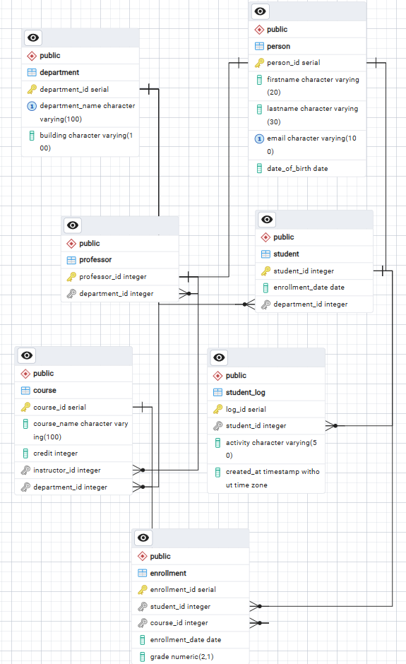

# Student Database Management System (S-DBMS)

A relational database management system for managing student information using Python and PostgreSQL.

## About the Project

S-DBMS is a database management project developed to demonstrate relational database design, SQL and database connectivity with Python.

The application connects Python to a PostgreSQL database and provides CRUD (Create, Read, Update, Delete) operations for managing student records.

## Features

- Create new students
- Display all students
- Update student information
- Delete student records
- PostgreSQL database connectivity
- Secure configuration using environment variables

## Technologies

| Technology | Purpose |
|---|---|
| Python | Application logic |
| PostgreSQL | Relational database |
| Psycopg 3 | PostgreSQL adapter |
| SQL | Database design and queries |
| python-dotenv | Environment variable management |

## Project Structure

```text
S-DBMS/
├── Python/
│   ├── database.py
│   ├── students.py
│   ├── main.py
│   ├── requirements.txt
│   └── .env.example
├── SQL/
├── sdbms.pgerd
├── sdbms.png
├── .gitignore
└── README.md
```

## Database Design

The database is implemented using PostgreSQL and contains the following tables:

- Person
- Student
- Professor
- Department
- Course
- Enrollment
- student_log

The database uses primary keys, foreign keys, constraints, relationships, triggers and views.

### Entity Relationship Diagram



## Installation and Setup

### 1. Clone the repository

```bash
git clone <repository-url>
cd S-DBMS
```

### 2. Install dependencies

```bash
cd Python
py -m pip install -r requirements.txt
```

### 3. Configure environment variables

Create a `.env` file based on `.env.example` and enter your PostgreSQL credentials.

### 4. Set up the database

- Open PostgreSQL using pgAdmin 4.
- Create or select a database.
- Execute the SQL scripts from the SQL directory.

### 5. Run the application

From the Python directory:

```bash
py main.py
```
